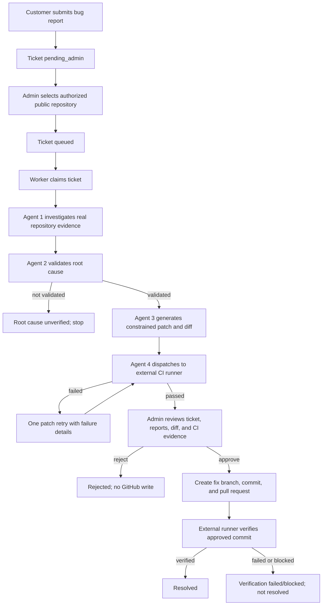

# BugHound Workflow Guide

This document describes the customer-to-admin workflow implemented in this React, FastAPI, and PostgreSQL project. No Docker or Docker Compose is used.

## Roles and portals

Customers and administrators use separate role-protected areas in the same React application. Login redirects each account to its role's dashboard.

- **Customer:** registers and tracks bug tickets. The customer does not choose a repository or start agents.
- **Administrator:** creates customer accounts, reviews new tickets, connects an authorized public repository, starts processing, reviews evidence and test results, then approves or rejects the proposed patch.
- **Worker:** polls PostgreSQL for tickets queued by an administrator and runs Agents 1-3. It never executes repository code.
- **External CI runner:** receives a patch or approved commit and runs tests/build/deployment checks in its own authorized isolated environment.

## End-to-end flow



### 1. Customer registers a ticket

From **Customer > Create Bug Ticket**, enter a title, description, and reproduction steps. No repository URL is collected at this stage. The API stores the ticket in PostgreSQL with status `pending_admin` and stage `admin_review`. No agents start during customer submission.

Attachments are not currently uploaded or persisted by the frontend.

### 2. Administrator connects the repository and starts processing

From **Admin > Tickets**, open a `Pending Admin Review` ticket. Enter the canonical public GitHub URL and select **Connect Repository & Start Agents**. The API:

1. Requires an administrator bearer token.
2. Validates the canonical `https://github.com/owner/repository` URL.
3. Checks `owner/repository` against `AUTHORIZED_REPOSITORIES`.
4. Saves the repository assignment and audit event, then changes the ticket to `queued`.

The button queues work; the separately running worker must be available to process it. A repository not on the allowlist is rejected. Public visibility alone is not authorization.

### 3. Agents investigate, validate, and generate a patch

The worker claims queued tickets from PostgreSQL using row locking and passes each agent's output to the next stage:

- **Agent 1 - Investigator:** uses GitHub's HTTPS API to inspect the public repository, its default branch, recent commits, tree, and selected source files. OpenRouter produces a report with evidence, assumptions, confidence, and a suspected root cause.
- **Agent 2 - Validator:** asks OpenRouter to evaluate Agent 1's report and evidence independently. If validation is false, processing stops at `root_cause_unverified`.
- **Agent 3 - Patch Generator:** asks OpenRouter for corrected contents for up to three selected existing source files. The backend rejects paths outside the collected evidence, unsafe paths, duplicates, and files over 40 KB. It creates a unified diff and does not add files, change dependencies, or modify workflows.
- **Agent 4 - Testing:** sends the diff, base commit, and patch digest to the configured external runner. The FastAPI host does not clone or execute repository code.

If the test runner reports a failure, Agent 3 receives the failure report for one retry. A second failure ends in `tests_failed`. A test is never marked passed unless the runner reports executed work, exit code zero, a secure HTTPS run URL, and identifiers matching the exact base commit and patch digest.

### 4. Administrator approves or rejects

Only a ticket in `awaiting_approval` with a generated patch and an actual passing Agent 4 result can be approved. The review screen shows the ticket, repository/base commit, investigation and validation reports, changed files, unified diff, and runner report/logs.

- **Reject:** records an audit event and changes the ticket to `rejected`. No GitHub write occurs.
- **Approve:** requires configured GitHub write authorization and rechecks that the default branch still points to the analyzed base commit. The backend creates a `bughound/ticket-<id>-<sha>` branch, commits the approved files, and opens a pull request. The default/production branch is never written directly. Automatic merging is disabled.

If GitHub authorization or branch creation fails, the ticket is reported as blocked; it is not falsely marked resolved.

### 5. Verify the approved pull request

After the pull request is created, the backend dispatches `post_pr_verification` to the external runner. The runner must test the approved commit SHA and report real build and test outcomes. Deployment and health checks must be `passed` or explicitly `not_configured`. Only a passing callback bound to the approved commit can change the ticket to `resolved`; failures remain `verification_failed` and dispatch/configuration errors remain blocked.

The external runner is an integration contract, not included in this repository. It must provide disposable isolation, resource limits, TLS, and authenticated callbacks. It must never send untrusted repository code to the FastAPI host for execution.

## Runner protocol

The worker sends an authenticated JSON `POST` to `CI_RUNNER_URL`. The request contains `ticket_id`, a persisted backend-generated `run_id`, `phase` (`patch_tests` or `post_pr_verification`), repository URL/name, base branch and commit SHA, fix branch, `patch_diff` and `patch_sha256` for patch tests, approved `resulting_commit_sha` for post-PR verification, and `callback_url`. The runner must accept the request with HTTP `200` or `202` and echo the same `run_id`. A missing or mismatched run ID is treated as a dispatch failure.

After the isolated run finishes, the runner sends a JSON `POST` to `callback_url` with `X-Runner-Secret: <RUNNER_CALLBACK_SECRET>`. The body must contain:

- `phase`, matching `run_id`, and `status` (`passed`, `failed`, or `cancelled`)
- `executed` (boolean), `exit_code`, `run_url` (HTTPS), `summary`, and bounded `logs`
- For `patch_tests`, the exact `base_commit_sha` and `patch_sha256` received in the dispatch
- For `post_pr_verification`, `tested_commit_sha` matching the approved commit and a `verification` object with actual `build` and `tests` statuses, plus `deployment` and `health_check` set to `passed` or `not_configured`

The API accepts a `passed` result only when `executed` is true, `exit_code` is zero, the HTTPS run URL is present, and the reported commit/patch identifiers match the persisted ticket run. Post-PR success also requires passing build and test statuses. The callback secret must be high entropy and transmitted only over TLS.

## Ticket states

| State | Meaning |
| --- | --- |
| `pending_admin` | Customer submitted a ticket; repository has not been assigned. |
| `queued` | Admin assigned an allowlisted repository; worker may claim it. |
| `queued_worker` | Worker claimed the ticket. |
| `investigating`, `validating`, `patching`, `testing` | Agent pipeline stages. |
| `root_cause_unverified` | Agent 2 did not validate the proposed cause; processing stopped. |
| `awaiting_approval` | External runner reported actual passing patch tests. |
| `tests_failed`, `testing_blocked`, `workflow_failed` | Test, service configuration, or agent workflow failed; inspect `error_message` and agent runs. |
| `rejected` | Admin rejected the patch; GitHub was not updated. |
| `verifying` | Admin approved and a PR exists; post-PR verification is running. |
| `github_blocked`, `verification_blocked`, `verification_failed` | GitHub write or final verification could not complete. |
| `resolved` | External runner verified the approved commit and required checks. |

Agent runs and audit events are persisted in `agent_runs` and `audit_logs`.

## Configuration and startup

Copy `backend/.env.example` to `backend/.env`, fill in local values, and never commit the `.env` file. `DATABASE_URL`, `JWT_SECRET` (at least 32 characters), and `CORS_ORIGINS` are required for normal local startup. The initial administrator is created with `python -m app.bootstrap_admin`; when credentials are not set in environment variables, the script prompts in the terminal and hides password input.

From the project root on Windows PowerShell, create/use the Python environment and install dependencies:

```powershell
py -3.14 -m venv backend\.venv
backend\.venv\Scripts\python.exe -m pip install -r backend\requirements.txt
```

Set `.env` values and create the PostgreSQL database, then start the backend from one terminal:

```powershell
Set-Location backend
.\.venv\Scripts\python.exe -m alembic upgrade head
.\.venv\Scripts\python.exe -m app.bootstrap_admin
.\.venv\Scripts\python.exe -m uvicorn app.main:app --host 127.0.0.1 --port 8000
```

Start the agent worker in a second terminal only after configuring OpenRouter and an authorized repository:

```powershell
Set-Location backend
.\.venv\Scripts\python.exe -m app.worker
```

Start the React app from the project root in another terminal:

```powershell
npm install
npm run dev
```

Local URLs: React `http://localhost:5173`, API `http://localhost:8000`, API docs `http://localhost:8000/docs`. Use `/health/live` for process liveness and `/health/ready` for database/API readiness. The login route is `/api/auth/login` (not `/api/v1/auth/login`).

### Required integration settings

- `AUTHORIZED_REPOSITORIES`: comma-separated exact `owner/repository` names; no wildcard. List only repositories the organization explicitly authorizes.
- `OPENROUTER_API_KEY` and `OPENROUTER_MODEL`: required for real agent responses. Missing credentials fail the workflow; no mock response is substituted.
- `GITHUB_TOKEN`: needed after admin approval to create a branch, commit, and pull request. Grant least-privilege access only to authorized repositories.
- `CI_RUNNER_URL`, `CI_RUNNER_TOKEN`, `RUNNER_CALLBACK_SECRET`, and `PUBLIC_API_URL`: needed for external patch tests and post-PR verification. `PUBLIC_API_URL` must be reachable over HTTPS by the runner outside localhost.
- `CORS_ORIGINS`: local default supports both `http://localhost:5173` and `http://127.0.0.1:5173`.

## API routes

All routes are under `/api` unless noted. Authenticated routes require `Authorization: Bearer <access-token>`.

| Method and route | Role | Purpose |
| --- | --- | --- |
| `POST /api/auth/login` | Public | Authenticate and return a role-bearing access token. |
| `GET /api/auth/me` | Customer/admin | Return the authenticated account. |
| `PATCH /api/auth/profile` | Customer/admin | Update display name and company. |
| `POST /api/auth/change-password` | Customer/admin | Change password with current-password verification. |
| `POST /api/admin/customers` | Admin | Create a customer account. |
| `GET /api/admin/customers` | Admin | List customer accounts. |
| `POST /api/tickets` | Customer | Register a bug report without repository assignment. |
| `GET /api/tickets` | Customer/admin | List owned tickets (customer) or all tickets (admin). |
| `GET /api/tickets/{id}` | Customer/admin | Read an owned ticket or any ticket as admin. |
| `GET /api/tickets/{id}/agents` | Customer/admin | Read persisted agent executions for an accessible ticket. |
| `GET /api/tickets/{id}/repository` | Customer/admin | Read repository snapshot after inspection. |
| `POST /api/admin/tickets/{id}/repository` | Admin | Assign allowlisted repository and queue the agent workflow. |
| `POST /api/admin/tickets/{id}/approve` | Admin | Approve a tested patch, create branch/commit/PR, dispatch final verification. |
| `POST /api/admin/tickets/{id}/reject` | Admin | Reject a patch awaiting approval. |
| `GET /api/admin/integrations`, `GET /api/admin/audit` | Admin | Read integration configuration state and audit records. |
| `POST /api/runner/tickets/{id}/result` | CI runner | Submit authenticated execution results. |

## Current local blockers

Configuration is environment-specific. Check `/health/ready` and `/api/admin/integrations` rather than assuming services are connected. If OpenRouter or the runner is missing, an admin can still register the ticket and assign its authorized repository, but agent/test stages will be recorded as blocked. GitHub write access is needed only for approved PR creation. Do not start the worker until OpenRouter and authorized repositories are configured.

Run backend tests from the `backend` directory with `python -m pytest`. No Docker or Docker Compose is required or supported by these instructions.